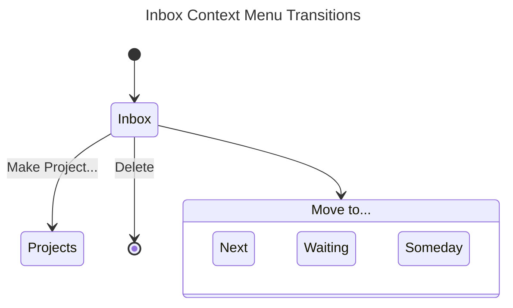
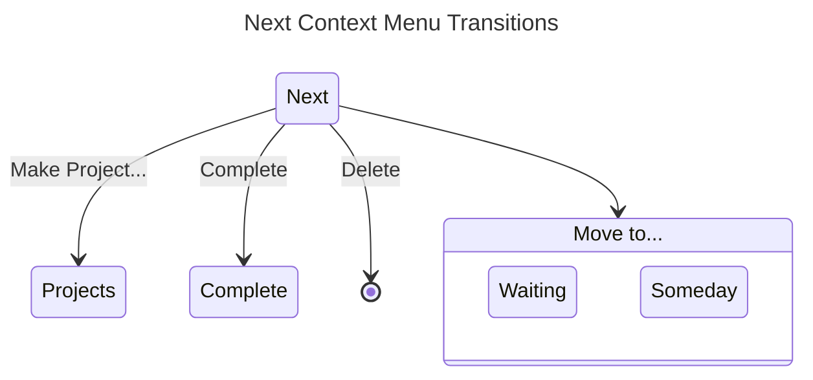
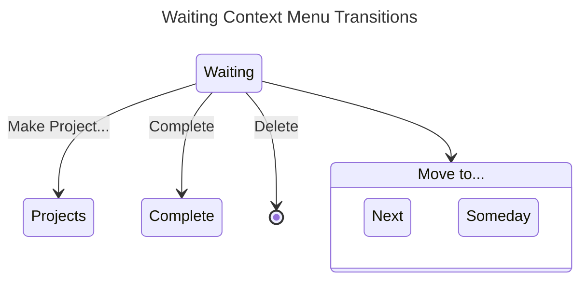
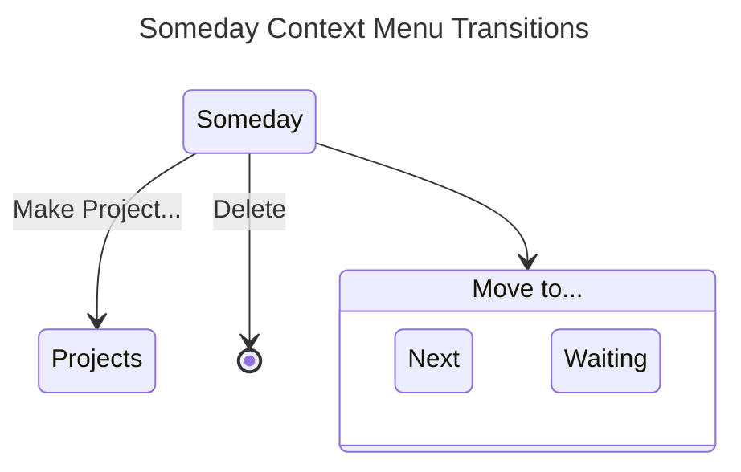
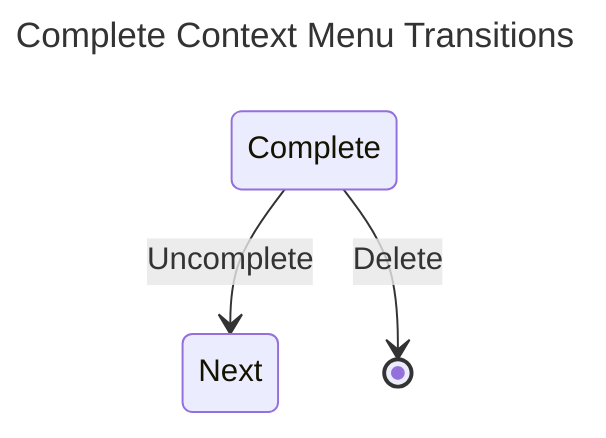

## Context Menus
Context menus are for now the primary means of moving tasks between tabs. Below are the valid menu entries for each tab.

## Transitions
These are the inputs the user can enter when moving a task from one status to another as in the above diagrams.
### To Inbox
Inputs: 
> description

### To Next
Inputs:
> Scheduled Date

> Due Date

### To Waiting
Inputs:
> Scheduled Date

> Due Date

> Notes

### To Projects
Inputs: _incomplete, finish me!_

### To Someday
Inputs: _none_